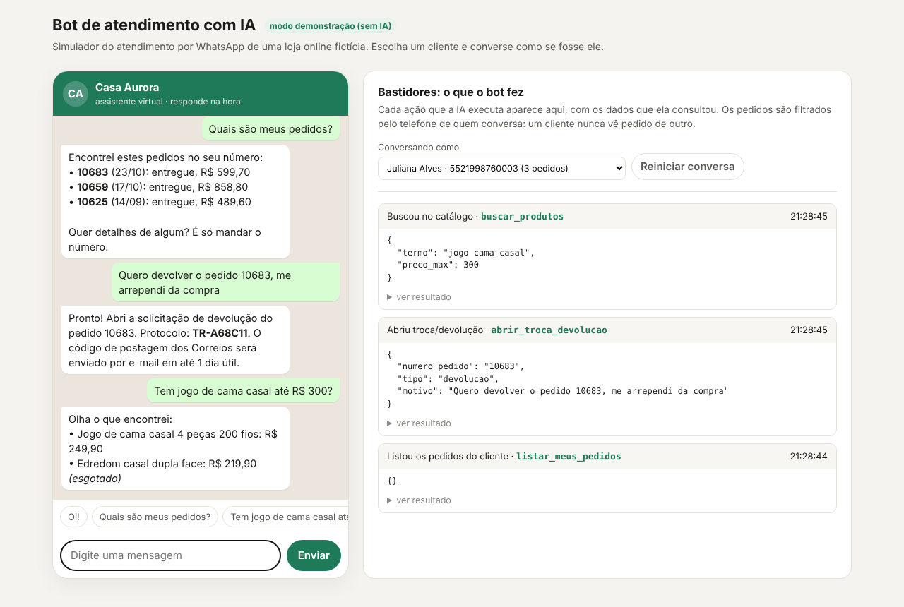
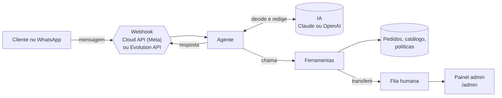

# Bot de atendimento com IA para WhatsApp: loja online

> Atende clientes de uma loja online pelo WhatsApp 24 horas por dia: consulta pedidos, encontra produtos, explica
> frete e pagamento, abre trocas e devoluções e passa para um humano quando precisa.



## O problema

Em uma loja online, a maior parte das mensagens no WhatsApp é repetitiva: *"cadê meu pedido?"*, *"qual o prazo?"*,
*"aceita Pix?"*, *"como faço para trocar?"*. A equipe perde horas respondendo a mesma coisa, o cliente espera e as
vendas fora do horário comercial ficam sem resposta.

## O que o bot faz

| O cliente pergunta | O bot |
|---|---|
| "Cadê meu pedido 10683?" | Consulta status, itens, rastreio e previsão de entrega |
| "Quais são meus pedidos?" | Lista os pedidos do número que está conversando |
| "Tem jogo de cama casal até R$ 300?" | Busca no catálogo com preço e disponibilidade |
| "Qual o prazo? Aceita Pix?" | Responde com as políticas oficiais da loja, sem inventar regra |
| "Quero devolver, me arrependi" | Confere o prazo (7 dias do CDC para arrependimento, 30 para troca) e abre a solicitação com protocolo |
| "Quero falar com uma pessoa" | Transfere para a fila humana, e o bot para de responder naquela conversa |

### Pontos que fazem diferença em produção

- **Privacidade por padrão.** As ferramentas recebem o telefone de quem está falando, não um telefone informado
  pela IA. Mesmo que alguém peça o pedido de outra pessoa, ou tente enganar o modelo, o bot só enxerga os pedidos
  daquele número.
- **A IA não inventa.** Prazos, preços, estoque e regras vêm sempre das ferramentas. O prompt proíbe responder essas
  informações de memória.
- **Passagem para humano de verdade.** Ao transferir, a conversa vai para a fila e o bot fica em silêncio até o
  atendente devolvê-la. Pedidos de Procon, irritação ou assuntos fora do escopo também disparam a transferência.
- **Robustez de webhook.** Valida a assinatura da Meta, ignora reenvios duplicados, responde 200 na hora e processa a
  IA em segundo plano, como a Meta exige.
- **Custo e risco sob controle.** Limite de chamadas de ferramenta por mensagem, histórico curto e modelo configurável
  (um modelo menor e barato já atende bem esse tipo de conversa).
- **Falhas tratadas.** Se a API de IA cair, o cliente recebe uma mensagem educada e a opção de chamar um atendente.

## Arquitetura



- **FastAPI** para os webhooks, o simulador e o painel administrativo.
- **Agente com *tool calling*** num formato neutro: o mesmo histórico funciona com **Claude (Anthropic)** ou
  **GPT (OpenAI)**. Trocar de provedor é uma variável de ambiente.
- **Dois canais de WhatsApp:**
  - **Cloud API oficial da Meta**: recomendada para empresas, sem risco de bloqueio do número.
  - **Evolution API**: conexão por QR code, comum em PMEs. Não é oficial, então o número pode ser bloqueado.
- **SQLite** para pedidos, conversas e métricas. Em produção, as ferramentas consultam a plataforma da loja
  (Shopify, Nuvemshop, VTEX, Bling) e o banco vira Postgres, sem mudar o agente.

```
src/lojabot/
├── agente.py          # loop da IA: decide ferramentas, executa, responde
├── ferramentas.py     # pedidos, catálogo, políticas, troca/devolução, transferência
├── llm/               # adaptadores Anthropic, OpenAI e modo demo
├── canais/            # Cloud API (Meta) e Evolution API
├── app.py             # webhooks, simulador e painel admin
└── static/            # simulador web
```

## Como rodar

```bash
pip install -e ".[dev]"
cp .env.example .env          # escolha LLM_PROVEDOR e coloque sua chave
python -m uvicorn lojabot.app:app --reload
```

Abra **http://localhost:8000/simulador**, escolha um cliente fictício e converse. O painel da direita mostra cada
ação que o bot executou e os dados que consultou.

Sem chave de API, o projeto roda em **modo demonstração** (`LLM_PROVEDOR=demo`): regras simples fazem o papel da IA,
passando pelo mesmo fluxo de ferramentas. É o modo usado nos testes e na imagem acima. Ele entende só frases
simples; para conversas naturais, use `anthropic` ou `openai`.

**Docker:** `docker compose up --build`

**Testes:** `pytest -q` (27 testes: privacidade, prazos de troca, transferência, webhooks, assinatura, deduplicação,
conversão para cada provedor de IA)

## Conectando ao WhatsApp

**Cloud API (Meta)**
1. Crie um app em developers.facebook.com, adicione o produto WhatsApp e pegue o *token*, o *phone number ID* e o
   *app secret*.
2. Preencha `META_*` e `CANAL=meta` no `.env`.
3. Configure o webhook para `https://SEU-DOMINIO/webhook/meta`, com o mesmo `META_VERIFY_TOKEN`, e assine o campo
   `messages`. Para testar localmente, exponha a porta com ngrok ou Cloudflare Tunnel.

**Evolution API**
1. Suba uma instância da Evolution API e conecte o número pelo QR code.
2. Preencha `EVOLUTION_*` e `CANAL=evolution`.
3. Aponte o webhook da instância para `https://SEU-DOMINIO/webhook/evolution?token=SEU_EVOLUTION_WEBHOOK_TOKEN`, com
   o evento `MESSAGES_UPSERT`.

## Painel administrativo

Todas as rotas exigem o cabeçalho `X-Admin-Token`.

| Rota | Para quê |
|---|---|
| `GET /admin/conversas?status=humano` | Fila de conversas esperando atendente |
| `GET /admin/conversas/{telefone}/mensagens` | Histórico da conversa |
| `POST /admin/conversas/{telefone}/responder` | Atendente responde pelo mesmo canal |
| `POST /admin/conversas/{telefone}/devolver` | Devolve a conversa para o bot |
| `GET /admin/metricas` | % resolvido sem humano, transferências, trocas abertas, uso de cada ferramenta |

A documentação interativa da API fica em `/docs`.

## Adaptando para outra empresa

O que muda de uma loja para outra está em três lugares: as **ferramentas** (de onde vêm pedidos e produtos), as
**políticas** (texto oficial de trocas, frete e pagamento) e o **prompt** (tom de voz e regras de transferência).
O mesmo esqueleto atende clínicas (agendamento), restaurantes (cardápio e pedidos) e prestadores de serviço.

## Sobre os dados

Loja, clientes, telefones e pedidos são **fictícios**, gerados em `db.py`. Os e-mails usam o domínio reservado
`example.com`.

## Autor

**Vitor Hugo Santos**: analista de crédito e dados. Desenvolvo chatbots com IA, automações e integrações
entre sistemas para empresas.

[LinkedIn](https://www.linkedin.com/in/vitor-hugosantos) · [Workana](https://www.workana.com/freelancer/b222e6ac36735ca36431f5734c3e302a)

---
Licença MIT
